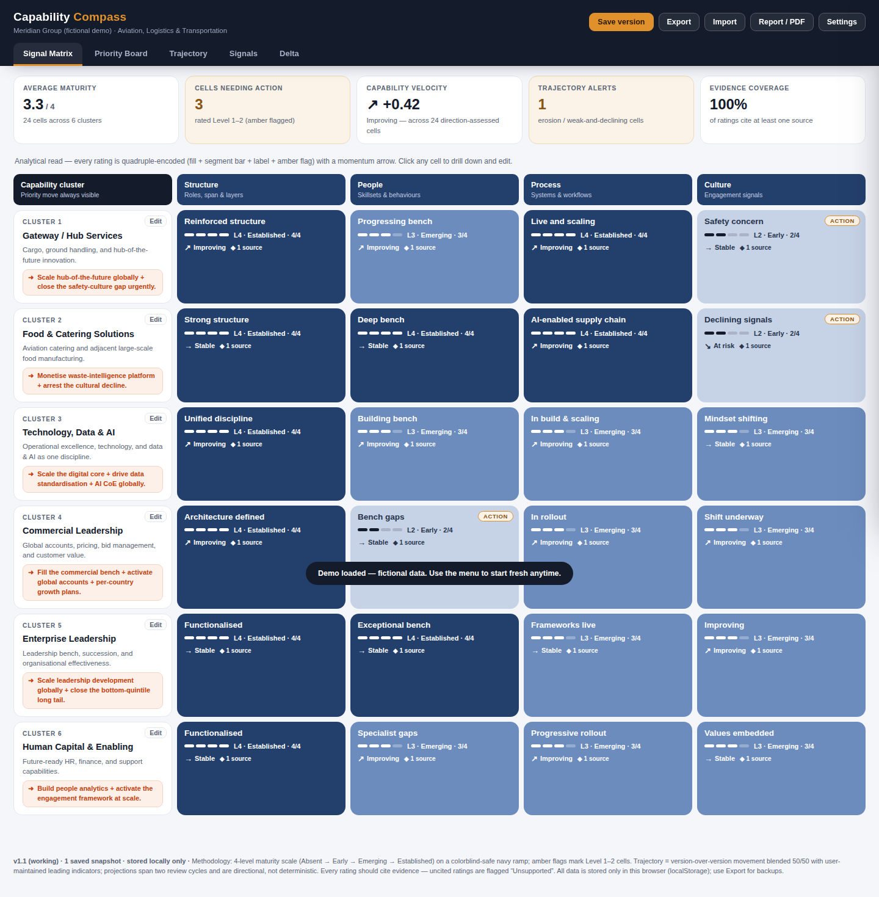
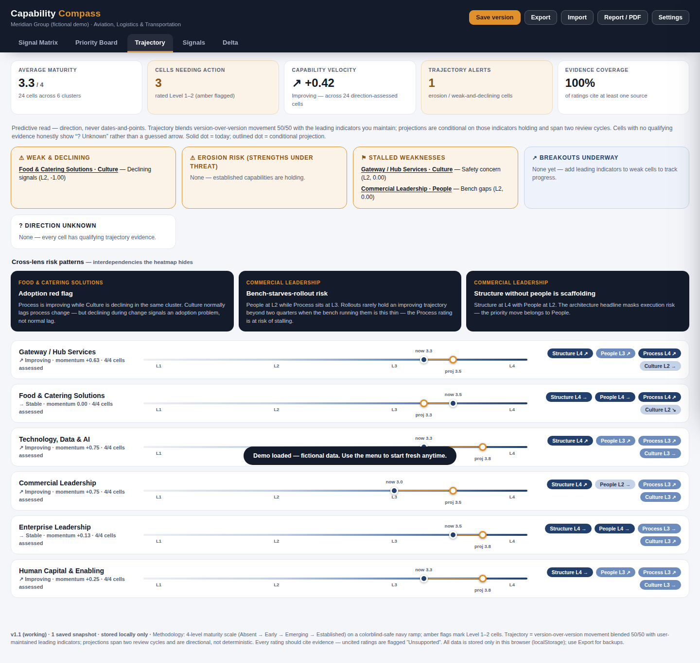
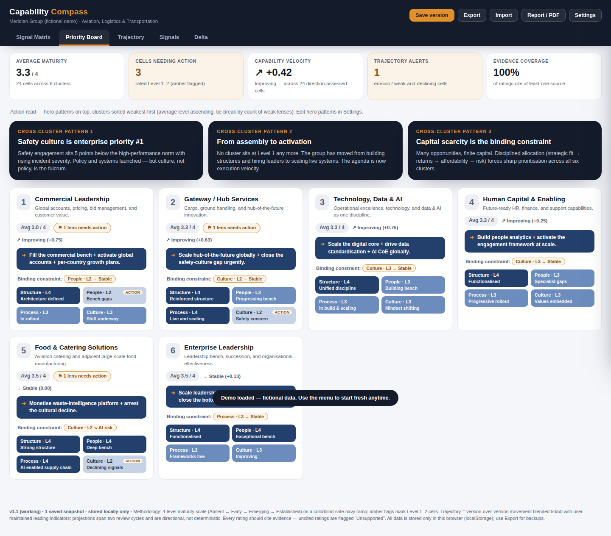
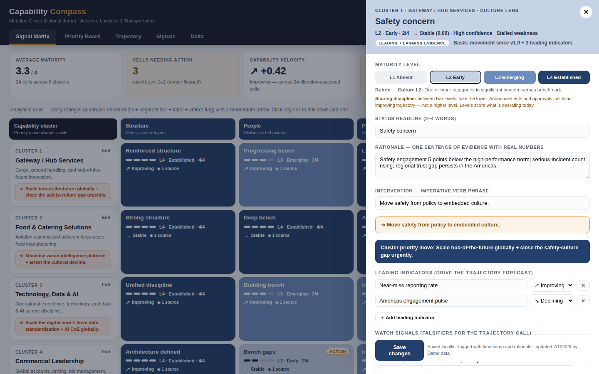
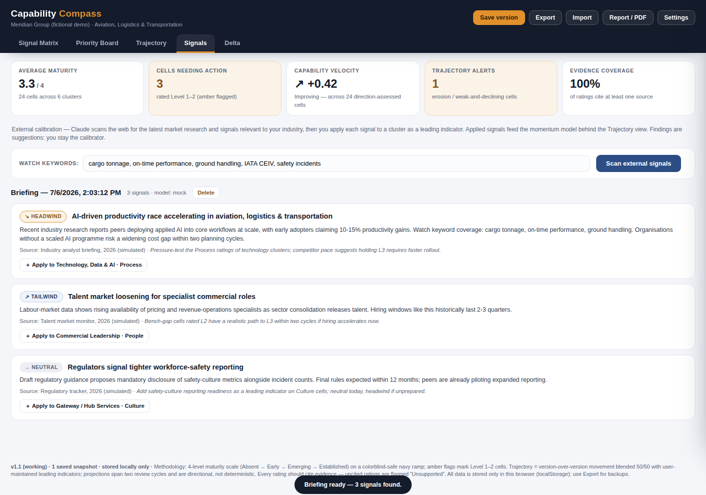

# Capability Compass — Organizational Capability Diagnostic

A **holistic and directionally predictive** capability diagnostic you run entirely on your own computer. It answers four questions on one canvas:

> **Where do we stand? Why? Where are we heading? What must we do next?**

- **Signal Matrix** — the analytical read: every capability cluster scored across Structure, People, Process, and Culture on a colorblind-safe 4-level maturity scale, with evidence citations.
- **Priority Board** — the action read: cross-cluster hero patterns on top, clusters sorted weakest-first, the priority move for each always visible.
- **Trajectory** — the predictive read: momentum per cell (from version history + leading indicators you maintain), early-warning alerts (*erosion risk*, *stalled weakness*, *breakout underway*), and a directional projection two review cycles ahead.
- **Signals** — the external read (optional, uses your own Claude API key): scans the latest market research, competitor moves, and regulatory shifts for your industry, then lets you apply each signal to a cluster as a leading indicator — recalibrating the trajectory forecast against the outside world.
- **Delta** — the recalibration read: exactly what changed since any saved baseline, declines first, with the logged rationale for every move.



**No installation, no account, no server, no technical skills required.** It's a single web page that runs in your browser. All data stays on your machine.

---

## 🚀 How to deploy locally (step by step, non-technical)

### Option A — Download and double-click (recommended, ~2 minutes)

1. **Download the app.** On this GitHub page, click the green **`< > Code`** button (top right of the file list), then click **Download ZIP**.
   - *Make sure you are on the branch containing the app (`claude/org-diagnostic-system-app-syt54v` if it hasn't been merged to `main` yet — use the branch dropdown at the top left of the file list).*
2. **Unzip it.** Find the downloaded file (usually in your *Downloads* folder) and double-click it (Mac) or right-click → **Extract All…** (Windows).
3. **Open the app.** Inside the unzipped folder, open the **`app`** folder and double-click **`index.html`**. It opens in your normal web browser (Chrome, Edge, or Safari — any of them works).
4. **Take the guided start.** A welcome screen appears:
   - Click **“▶ Explore the demo”** to see a fully populated example (fictional company) — the best way to learn the tool, **or**
   - Pick your **industry preset** (Aviation & Logistics, Financial Services, Technology/SaaS, Healthcare, Manufacturing, Public Sector, or Generic), preview the suggested clusters, type your organisation's name, and click **Generate diagnostic**.
5. **That's it — you're deployed.** Bookmark the page or keep the folder anywhere you like (Desktop, Documents, a USB stick — it all works).

### Option B — One command (if you're comfortable with a terminal)

```bash
git clone https://github.com/kaizen74/org_capability_diagnostic.git
cd org_capability_diagnostic/app
python3 -m http.server 8080
```
Then open **http://localhost:8080** in your browser. (Any static file server works; none is required — Option A needs no terminal at all.)

### Troubleshooting

| Problem | Fix |
|---|---|
| Double-clicking opens the file in a text editor | Right-click `index.html` → **Open With** → choose Chrome, Edge, or Safari. |
| The page looks unstyled or empty | Make sure you unzipped the whole folder and kept `index.html` next to its `css` and `js` folders — don't move the file out on its own. |
| Fonts look plain | You're offline — the app falls back to system fonts and everything still works. |
| "My data disappeared" | Data is saved per browser. If you switch browsers or clear browsing data, restore from a JSON backup (see below). |

---

## 📖 How to use it (5-minute tour)

1. **Rate a capability.** Click any cell in the Signal Matrix. A drawer slides in: pick the maturity level (the rubric definition for that lens and level is shown), write a 2–4 word status headline, a one-sentence rationale **with real numbers**, and an intervention.
2. **Ground it in evidence.** In the same drawer, add at least one evidence source (e.g. “Engagement Survey 2026”). Cells with no sources are visibly flagged **Unsupported** — that's deliberate.
3. **Make it predictive.** Add 1–3 **leading indicators** per cell (e.g. *specialist hiring funnel*, *CRM adoption rate*, *near-miss reporting rate*) and mark each improving / stable / declining. These drive the Trajectory view's momentum and forecasts.
4. **Save a version** (top bar) at every recalibration moment — quarterly refresh, engagement-survey release, leadership change, strategy offsite. Snapshots power the **Delta** view and anchor the momentum baseline.
5. **Change a level later** and the app requires a written rationale — every move is logged with timestamp and author (full audit trail).
6. **Brief the board.** Click **Report / PDF** to print the current view as a clean briefing (choose “Save as PDF” in the print dialog). Use **Export** for a complete JSON backup you can archive or move to another computer (**Import** restores it).





### Calibrating against external market research (Signals)

1. Open **Settings → External intelligence** and paste your Anthropic API key (get one at [console.anthropic.com](https://console.anthropic.com) → API Keys). Pick a model — Claude Opus 4.8 is the default; Sonnet or Haiku are cheaper. Click **Test connection**, then **Save settings**.
   - *No key yet? Type `mock` as the key to try the whole feature with realistic simulated data — free and offline.*
2. Open the **Signals** tab. The watch keywords are pre-filled from your industry preset — edit them to match what matters to you (e.g. `cargo tonnage, IATA, safety incidents`).
3. Click **Scan external signals**. Claude searches the web for the latest relevant research and returns 3–5 signals, each tagged **Tailwind / Headwind / Neutral** with a source and a calibration note.
4. On any signal, click **Apply to [cluster] · [lens]**. That records the signal as a *leading indicator* and an *evidence source* on the matching cell — it immediately feeds the momentum model, so the Trajectory view now reflects the outside world, not just your internal history. You remain the calibrator: nothing changes a rating automatically.



**Key safety:** your API key lives only in this browser, in storage separate from the diagnostic data, so it can never appear in an Export file, a report, or a backup. It is sent only to Anthropic's API, directly from your machine. Remove it anytime with **Settings → Remove key**.

### How the prediction works (in one paragraph)

Each cell's **momentum** blends two signals 50/50: how its level moved since your last saved version, and the state of the leading indicators you maintain on it. Momentum ≥ +0.25 projects one level up over the next two review cycles; ≤ −0.25 projects one level down — always phrased conditionally (*"toward L3 IF indicators hold"*). Cells are classified into an early-warning vocabulary — *weak & declining*, *erosion risk* (a strength being lost), *stalled weakness*, *breakout underway*, *compounding strength*. Four honesty rules keep the forecasts defensible: a cell with **no** trajectory evidence shows **`? Unknown`** rather than a guessed arrow (and if over a quarter of cells are unknown, the dashboard tells you the real finding is an evidence gap); every trajectory carries a **confidence** grade derived mechanically from its evidence; cells scored only on rear-view sources are flagged **"rear-view evidence only"**; and every cell can hold **watch signals** — falsifiable thresholds that would prove the trajectory call wrong and force a re-score. The Trajectory view also detects **cross-lens risk patterns** the heatmap hides (e.g. a thin bench starving a systems rollout, or culture declining *during* a process change — an adoption red flag), and every Priority Board card names its **binding constraint**: the lowest-level cell that isn't already improving, which is where intervention bites first.

---

## 🔒 Privacy

Everything runs and stays in your browser (localStorage). No server, no account, no analytics, no data ever leaves your machine. The only network access is optional font loading. Use **Export** regularly to keep JSON backups.

## 📁 What's in this repository

```
app/                  ← the application (open app/index.html to run)
  index.html
  css/styles.css
  js/schema.js        ← shared data contract (validated at runtime AND in tests)
  js/presets.js       ← 7 industry presets + fictional demo data (edit freely)
  js/engine.js        ← the transparent predictive engine
  js/llm.js           ← Claude API client (external signals) + offline mock mode
  js/app.js           ← views, drawer, wizard, persistence
tests/
  contract_test.js    ← data-layer ↔ UI-layer alignment checks (node tests/contract_test.js)
  e2e_mock_test.js    ← full browser regression in mock mode (never calls the real API)
docs/
  Capability_Compass_PRD_v3.md          ← revised product spec (v2 → v3 changelog inside)
  Capability_Diagnostic_Rubric_v4.md    ← revised, industry-agnostic scoring standard
  capability_dashboard_skill_v2.md      ← revised dashboard design skill
  IMPROVEMENTS.md                       ← research basis for all revisions (with sources)
  screenshots/
```

## 🧭 Design system & methodology

4-level maturity scale (Absent → Early → Emerging → Established) on a colorblind-safe single-hue navy ramp — never traffic-light red/green. Every rating is quadruple-encoded (fill + segment bar + text label + amber action flag). Weakest-first sorting biases the eye toward what needs attention. Every rating cites evidence or is flagged. Every change is logged. See `docs/` for the full standard.

## 🧪 Testing (for the curious)

Two automated suites keep the app healthy and its layers aligned — both run without ever calling the real Claude API (they use the built-in mock mode):

```bash
node tests/contract_test.js    # data contract: presets, demo data, engine ranges,
                               # Claude-response shape, API-key isolation
node tests/e2e_mock_test.js    # full browser regression: wizard → rate → board →
                               # trajectory → signals scan → apply → persist → export
```

The same `app/js/schema.js` contract file is enforced at runtime (imports and API responses are validated before they touch the UI) and in the tests — so the data layer and the interface cannot silently drift apart.

## 🗺️ Roadmap (Pro Edition)

The PRD retains a full-stack "Pro" upgrade path — document ingestion with retrieval-augmented evidence, deeper Claude enrichment (cell synthesis, natural-language sense-making chat, delta narration), PPTX export, and multi-user deployments. The Local Edition's JSON export is the designed migration path. See `docs/Capability_Compass_PRD_v3.md`, Section 4.2.
