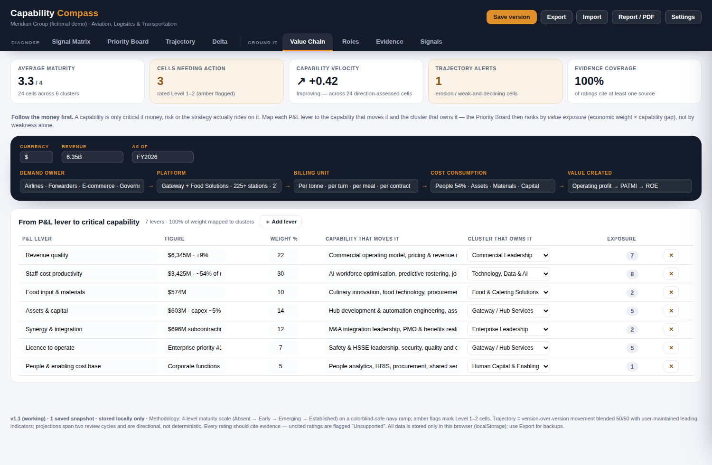
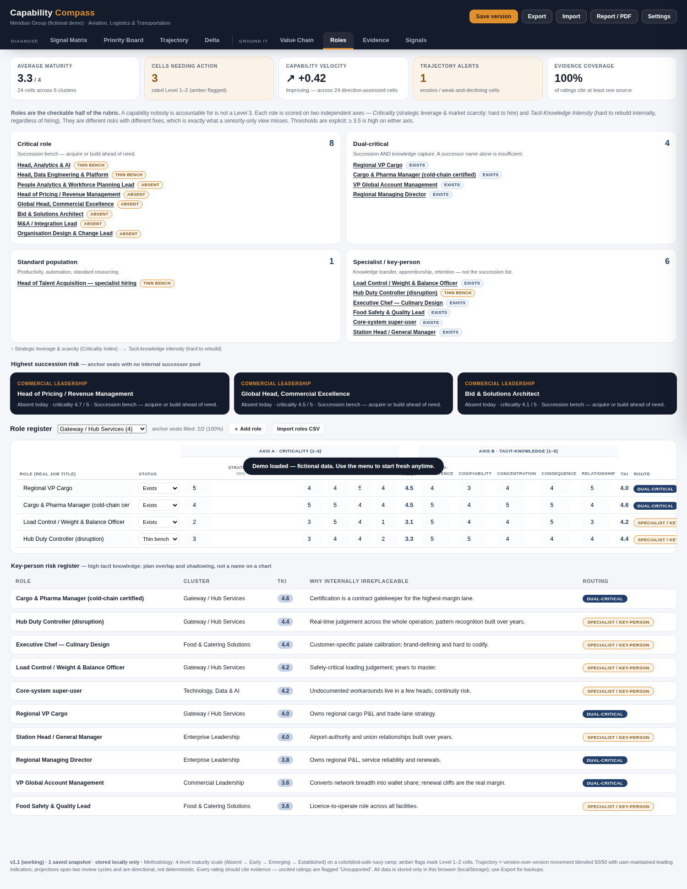
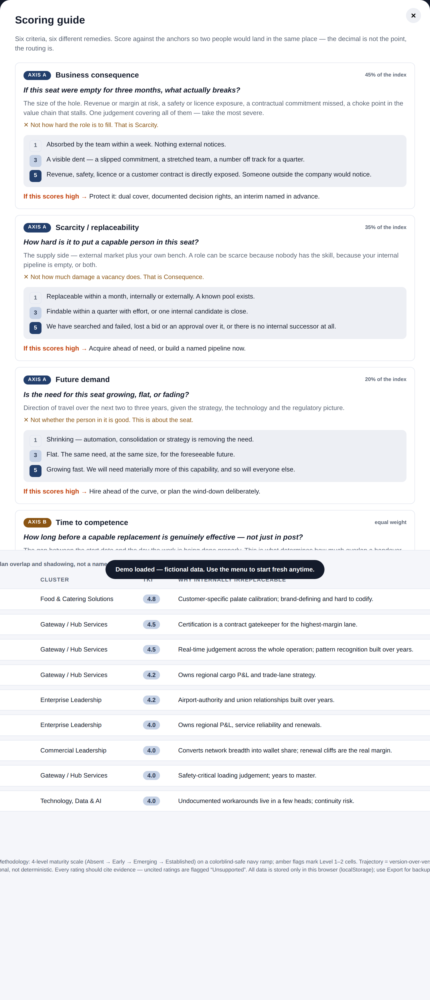
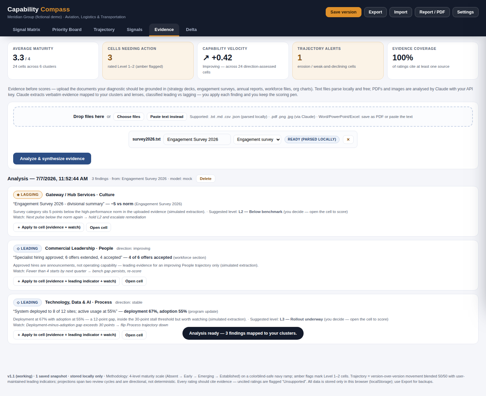
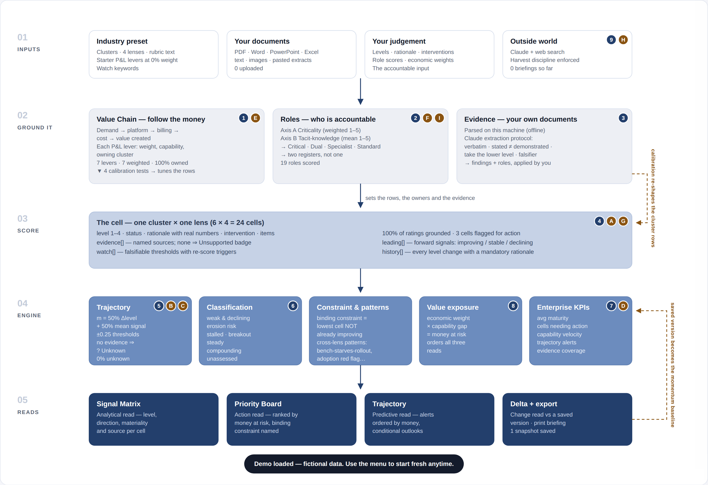

# Capability Compass — Organizational Capability Diagnostic

A **holistic and directionally predictive** capability diagnostic you run entirely on your own computer. It answers four questions on one canvas:

> **Where do we stand? Why? Where are we heading? What must we do next?**

- **Signal Matrix** — the analytical read: every capability cluster scored across Structure, People, Process, and Culture on a colorblind-safe 4-level maturity scale, with evidence citations.
- **Priority Board** — the action read: cross-cluster hero patterns on top, clusters sorted weakest-first, the priority move for each always visible.
- **Trajectory** — the predictive read: momentum per cell (from version history + leading indicators you maintain), early-warning alerts (*erosion risk*, *stalled weakness*, *breakout underway*), and a directional projection two review cycles ahead.
- **Signals** — the external read (optional, uses your own Claude API key): scans the latest market research, competitor moves, and regulatory shifts for your industry, then lets you apply each signal to a cluster as a leading indicator — recalibrating the trajectory forecast against the outside world.
- **Value Chain** — the economic precursor: follow the money from demand owner to profit, map each P&L lever to the capability that moves it, and the Priority Board switches from "weakest first" to **money at risk first**.
- **Blueprint** — one page showing how data becomes a decision here, with the method's strengths *and* its limits stated in the product, each with a mitigation.
- **Cluster calibration** — the money map doesn't just rank the clusters, it checks whether they are the *right* clusters for your business: money with no owner, clusters with no money, one cluster hiding two capabilities. One-click fixes, plus an optional Claude pass that researches how your industry organises the same work. Nothing structural changes without your approval.
- **Roles** — the accountability read: every anchor role scored on two independent axes — *Criticality* (hard to hire → succession bench) and *Tacit-Knowledge Intensity* (hard to rebuild internally → knowledge capture) — routing each into Critical / Dual-critical / Specialist / Standard, with two separate registers so knowledge-drain risk never hides inside a succession list.
- **Evidence** — the grounding read: upload your own documents (strategy decks, engagement surveys, annual reports, workforce files, org charts) and Claude runs an evidence-extraction protocol against your clusters and lenses — verbatim figures, leading vs lagging classification, conservative level suggestions, and falsifiable watch signals — each finding one click away from landing in the right cell.
- **Delta** — the recalibration read: exactly what changed since any saved baseline, declines first, with the logged rationale for every move.


**No installation, no account, no server, no technical skills required.** It's a single web page that runs in your browser. All data stays on your machine.

---

## 🚀 How to deploy locally (step by step, non-technical)

### Option A — Download and double-click (recommended, ~2 minutes)

1. **Download the app.** On this GitHub page, click the green **`< > Code`** button (top right of the file list), then click **Download ZIP**.
   - *Make sure you are on the branch containing the app (`claude/org-diagnostic-system-app-syt54v` if it hasn't been merged to `main` yet — use the branch dropdown at the top left of the file list).*
2. **Unzip it.** Find the downloaded file (usually in your *Downloads* folder) and double-click it (Mac) or right-click → **Extract All…** (Windows).
3. **Open the app.** Inside the unzipped folder, open the **`app`** folder and double-click **`index.html`**. It opens in your normal web browser (Chrome, Edge, or Safari — any of them works).
4. **Take the guided start.** A welcome screen appears:
   - Click **“▶ Explore the demo”** to see a fully populated example (fictional company) — the best way to learn the tool, **or**
   - Pick your **industry preset** (Aviation & Logistics, Financial Services, Technology/SaaS, Healthcare, Manufacturing, Public Sector, or Generic), preview the suggested clusters, type your organisation's name, and click **Generate diagnostic**.
5. **That's it — you're deployed.** Bookmark the page or keep the folder anywhere you like (Desktop, Documents, a USB stick — it all works).

### Option B — One command (if you're comfortable with a terminal)

```bash
git clone https://github.com/kaizen74/org_capability_diagnostic.git
cd org_capability_diagnostic/app
python3 -m http.server 8080
```
Then open **http://localhost:8080** in your browser. (Any static file server works; none is required — Option A needs no terminal at all.)

### Troubleshooting

| Problem | Fix |
|---|---|
| Double-clicking opens the file in a text editor | Right-click `index.html` → **Open With** → choose Chrome, Edge, or Safari. |
| The page looks unstyled or empty | Make sure you unzipped the whole folder and kept `index.html` next to its `css` and `js` folders — don't move the file out on its own. |
| Fonts look plain | You're offline — the app falls back to system fonts and everything still works. |
| "My data disappeared" | Data is saved per browser. If you switch browsers or clear browsing data, restore from a JSON backup (see below). |

---

## 📖 How to use it (5-minute tour)

1. **Rate a capability.** Click any cell in the Signal Matrix. A drawer slides in: pick the maturity level (the rubric definition for that lens and level is shown), write a 2–4 word status headline, a one-sentence rationale **with real numbers**, and an intervention.
2. **Ground it in evidence.** In the same drawer, add at least one evidence source (e.g. “Engagement Survey 2026”). Cells with no sources are visibly flagged **Unsupported** — that's deliberate.
3. **Make it predictive.** Add 1–3 **leading indicators** per cell (e.g. *specialist hiring funnel*, *CRM adoption rate*, *near-miss reporting rate*) and mark each improving / stable / declining. These drive the Trajectory view's momentum and forecasts.
4. **Save a version** (top bar) at every recalibration moment — quarterly refresh, engagement-survey release, leadership change, strategy offsite. Snapshots power the **Delta** view and anchor the momentum baseline.
5. **Change a level later** and the app requires a written rationale — every move is logged with timestamp and author (full audit trail).
6. **Brief the board.** Click **Report / PDF** to print the current view as a clean briefing (choose “Save as PDF” in the print dialog). Use **Export** for a complete JSON backup you can archive or move to another computer (**Import** restores it).


### Calibrating against external market research (Signals)

1. Open **Settings → External intelligence** and paste your Anthropic API key (get one at [console.anthropic.com](https://console.anthropic.com) → API Keys). Pick a model — Claude Opus 4.8 is the default; Sonnet or Haiku are cheaper. Click **Test connection**, then **Save settings**.
   - *No key yet? Type `mock` as the key to try the whole feature with realistic simulated data — free and offline.*
2. Open the **Signals** tab. The watch keywords are pre-filled from your industry preset — edit them to match what matters to you (e.g. `cargo tonnage, IATA, safety incidents`).
3. Click **Scan external signals**. Claude searches the web for the latest relevant research and returns 3–5 signals, each tagged **Tailwind / Headwind / Neutral** with a source and a calibration note.
4. On any signal, click **Apply to [cluster] · [lens]**. That records the signal as a *leading indicator* and an *evidence source* on the matching cell — it immediately feeds the momentum model, so the Trajectory view now reflects the outside world, not just your internal history. You remain the calibrator: nothing changes a rating automatically.


**Key safety:** your API key lives only in this browser, in storage separate from the diagnostic data, so it can never appear in an Export file, a report, or a backup. It is sent only to Anthropic's API, directly from your machine. Remove it anytime with **Settings → Remove key**.

### Establishing economic context first (Value Chain)

Score capabilities *after* you know where the money is. In the **Value Chain** tab, fill the five-stage flow (demand owner → platform → billing unit → cost consumption → value created), then list the handful of P&L levers that genuinely move the business. For each: a rough weight, the capability that moves it, and the cluster that owns it.

The Priority Board then ranks by **value exposure** (economic weight × capability gap) instead of weakness alone — so a Level 2 carrying 30% of your cost base outranks a Level 2 carrying 2%. Any lever with no cluster attached is flagged: that money has no capability owner.

To save you a blank page, picking an industry preset also lists **the P&L levers that usually matter in that industry**, each already pointed at the cluster that should own it. The weights are left at 0 on purpose — the app will never invent a number about your business. Until you enter real weights, the board keeps ranking weakest-first and says so.



### Checking you have the *right* clusters (Cluster calibration)

This is the part most capability models skip. An industry preset gives you a plausible set of clusters — it cannot know where *your* money actually flows. Scoring the wrong six rows carefully still gives you a careful answer to the wrong question.

So underneath the Value Chain table, the app continuously checks four things and tells you in plain English whether your cluster set fits your economics:

| Test | What it catches |
|---|---|
| **Ownership** | A P&L lever worth 3% or more with no cluster accountable for it |
| **Materiality** | A cluster carrying 0% of the money — often a preset default that doesn't fit your business |
| **Separability** | One cluster carrying 30%+ across two different levers — usually two capabilities sharing one score |
| **Diagnosability** | A weighted lever with no capability named, so nothing in the diagnostic can move it |

Each finding comes with a one-click fix — *add a cluster for this lever*, *split into two clusters*, *edit or remove this cluster* — and the Signal Matrix shows a banner when the mismatch is material.

With an API key you can also click **⟳ Tune clusters with Claude**, which researches how your industry actually organises the same capabilities and proposes changes: *add*, *merge*, *rename*, *split*, or explicitly *keep*, each with a rationale, a source where one exists, and a confidence level. **Nothing is ever applied automatically** — a merge or removal asks first and tells you exactly what it discards.

Once weights exist, materiality follows you everywhere: each Signal Matrix row shows the share of the P&L riding on it, the Matrix, Board and Trajectory views all order the same way, and trajectory alerts lead with the biggest money at risk.

### Scoring the roles behind each capability (Roles)

A capability nobody is accountable for is not a Level 3. In the **Roles** tab, score each anchor role on two independent axes and the app routes it automatically:

- **Criticality** — business consequence (45%), scarcity / replaceability (35%), future demand (20%). High score = *a lot rides on it and it is hard to fill* → the fix is a **succession bench**.
- **Tacit-Knowledge Intensity** — time to competence, locked in heads (undocumented and held by few), relationship capital. High score = *hard to rebuild internally even if you can hire* → the fix is **knowledge capture, overlap and apprenticeship**.

**Three criteria per axis, not five.** Ten criteria were cut to six: three of the old Axis-A criteria were all measuring the same thing (what breaks if the seat is empty), Axis B carried a duplicate of Axis A's consequence, and one weight was too small to ever change a routing decision. Each surviving criterion had to pass one test — *does it point at a different remedy?* Six criteria, six remedies.

**Every criterion explains itself where you score it.** Click any column heading (or the **ⓘ Scoring guide** button) for that criterion's question, what it covers, **what it explicitly does not** cover, its written 1 / 3 / 5 anchors, and the remedy a high score points at. Anchored scales are the biggest thing you can do to make two people score alike — bigger than adding criteria.

Scores from the earlier five-criterion version migrate automatically — in saved files, JSON imports and old CSV templates alike — and no role changes its route in the process.

That produces four routes — **Critical**, **Dual-critical**, **Specialist/key-person**, **Standard** — and two separate registers. The separation matters: a load-control officer or a long-tenured system super-user scores modestly on leverage but is internally irreplaceable, and a scarcity-only view files them under "standard" until the day they resign.

Record each role's status as *exists · thin bench · absent* using your real job titles. Absent anchor seats surface automatically as structural findings on the board and in the trajectory patterns. Bulk-load them with the **Import roles CSV** button (template in the Evidence tab), or let Claude extract them from your org chart.




### Grounding the diagnostic in your own documents (Evidence)

1. Open the **Evidence** tab and drop in your files — strategy decks, engagement survey results, annual reports, workforce files, org charts and job-title lists.
   - **.pdf, .docx (Word), .pptx (PowerPoint), .xlsx/.xls (Excel), .txt, .md, .csv, .json** all parse **locally in your browser** — offline, free, nothing leaves your machine. (The app ships with three bundled open-source parsers: pdf.js, SheetJS, and JSZip — still zero-install for you.) PowerPoint extraction includes speaker notes; Excel comes in as per-sheet tables.
   - **Scanned/image-only PDFs and images (.png/.jpg)** — org charts, photographed documents — are read natively by Claude using your API key.
   - Anything else (legacy .doc/.ppt, intranet pages, emails): use **Paste text instead**.
2. Give each document a **source label** (it propagates to every citation) and a **type** (strategy deck, engagement survey, board paper, workforce file, org chart…). Not sure what to gather? Download the built-in **templates**: an *Evidence checklist* (the ten documents that make a diagnostic defensible, and the lens each one grounds), a *Role inventory* CSV, and a *Value chain* CSV.
3. Click **Analyze & synthesize evidence**. Claude runs a strict extraction protocol — verbatim figures only, *stated ≠ demonstrated* (announcements count as trajectory evidence, never level evidence), between two levels suggest the lower — and returns findings mapped to specific **cluster × lens** cells, each classified **Leading** or **Lagging** with a rationale and a falsifiable watch signal.
4. Click **Apply to cell** on any finding: it lands in the cell as an evidence citation, plus a leading indicator (if directional) and a watch signal — feeding the momentum model immediately. **Level suggestions are never auto-applied** — click *Open cell* to score it yourself, with the suggestion in view. You keep the pen.
5. Privacy: text extracts live only in this browser; **PDF/image content is held in memory only** — it is never written to storage or exports, and after a restart the app honestly asks you to re-attach the file.



### How the prediction works (in one paragraph)

Each cell's **momentum** blends two signals 50/50: how its level moved since your last saved version, and the state of the leading indicators you maintain on it. Momentum ≥ +0.25 projects one level up over the next two review cycles; ≤ −0.25 projects one level down — always phrased conditionally (*"toward L3 IF indicators hold"*). Cells are classified into an early-warning vocabulary — *weak & declining*, *erosion risk* (a strength being lost), *stalled weakness*, *breakout underway*, *compounding strength*. Four honesty rules keep the forecasts defensible: a cell with **no** trajectory evidence shows **`? Unknown`** rather than a guessed arrow (and if over a quarter of cells are unknown, the dashboard tells you the real finding is an evidence gap); every trajectory carries a **confidence** grade derived mechanically from its evidence; cells scored only on rear-view sources are flagged **"rear-view evidence only"**; and every cell can hold **watch signals** — falsifiable thresholds that would prove the trajectory call wrong and force a re-score. The Trajectory view also detects **cross-lens risk patterns** the heatmap hides (e.g. a thin bench starving a systems rollout, or culture declining *during* a process change — an adoption red flag), and every Priority Board card names its **binding constraint**: the lowest-level cell that isn't already improving, which is where intervention bites first.

---

## 🔒 Privacy

Everything runs and stays in your browser (localStorage). No server, no account, no analytics, no data ever leaves your machine. The only network access is optional font loading. Use **Export** regularly to keep JSON backups.

## 📁 What's in this repository

```
app/                  ← the application (open app/index.html to run)
  index.html
  css/styles.css
  js/schema.js        ← shared data contract (validated at runtime AND in tests)
  js/presets.js       ← 7 industry presets + fictional demo data (edit freely)
  js/engine.js        ← the transparent predictive engine
  js/llm.js           ← Claude API client (external signals) + offline mock mode
  js/app.js           ← views, drawer, wizard, persistence
tests/
  contract_test.js    ← data-layer ↔ UI-layer alignment checks (node tests/contract_test.js)
  e2e_mock_test.js    ← full browser regression in mock mode (never calls the real API)
docs/
  Capability_Compass_PRD_v3.md          ← revised product spec (v2 → v3 changelog inside)
  Capability_Diagnostic_Rubric_v4.md    ← revised, industry-agnostic scoring standard
  capability_dashboard_skill_v2.md      ← revised dashboard design skill
  IMPROVEMENTS.md                       ← research basis for all revisions (with sources)
  screenshots/
```

## 🧭 Design system & methodology

4-level maturity scale (Absent → Early → Emerging → Established) on a colorblind-safe single-hue navy ramp — never traffic-light red/green. Every rating is quadruple-encoded (fill + segment bar + text label + amber action flag). Weakest-first sorting biases the eye toward what needs attention. Every rating cites evidence or is flagged. Every change is logged. See `docs/` for the full standard.

## 🗂️ Project files (for whoever maintains this next)

- **`GUIDE.md`** — plain-language user guide: what each view is for and the recommended order for a first real diagnostic.
- **`PROJECT_STATE.md`** — what is built, what is tested, what to do next. The source of truth for resuming work.
- **`DECISIONS.md`** — why the app is built the way it is, one line per decision.
- **`./run_checks.sh`** — runs every automated check in one command and says plainly whether it's safe to commit.

### Understanding — and defending — the method (Blueprint)

The **Blueprint** tab draws the whole workflow on one page: what you put in, how the Value Chain and Roles layers set the frame, what a cell actually holds, what the engine computes, and which reads come out — including the two feedback loops (calibration re-shapes the cluster rows; a saved version becomes the momentum baseline). The counters read your live diagnostic, so you can check any claim against your own data.

Underneath it, the app states its **own strengths and its own limits** — nine of each, every limit with a mitigation, each badged onto the exact stage it applies to. The two worth knowing before this reaches a board:

- **Single-rater scoring.** Every level is one person's judgement. Have a second assessor independently score the five or six cells carrying the most economic weight, and treat a two-level disagreement as an evidence gap rather than averaging it.
- **Momentum rests on one prior snapshot.** Save a version at every recalibration, and treat the first two cycles' direction as indicative only.

This is deliberate. The method is rigorous where rigour is cheap — provenance, falsifiability, transparent arithmetic, economics before categories — and honest that it is structured expert judgement, not a measurement instrument. Naming that first is what makes the rest credible.



## 🧪 Testing (for the curious)

Two automated suites keep the app healthy and its layers aligned — both run without ever calling the real Claude API (they use the built-in mock mode):

```bash
node tests/contract_test.js    # data contract: presets, demo data, engine ranges,
                               # Claude-response shape, API-key isolation
node tests/e2e_mock_test.js    # full browser regression: wizard → rate → board →
                               # trajectory → signals scan → apply → persist → export
```

The same `app/js/schema.js` contract file is enforced at runtime (imports and API responses are validated before they touch the UI) and in the tests — so the data layer and the interface cannot silently drift apart.

## 🗺️ Roadmap (Pro Edition)

The PRD retains a full-stack "Pro" upgrade path — document ingestion with retrieval-augmented evidence, deeper Claude enrichment (cell synthesis, natural-language sense-making chat, delta narration), PPTX export, and multi-user deployments. The Local Edition's JSON export is the designed migration path. See `docs/Capability_Compass_PRD_v3.md`, Section 4.2.
